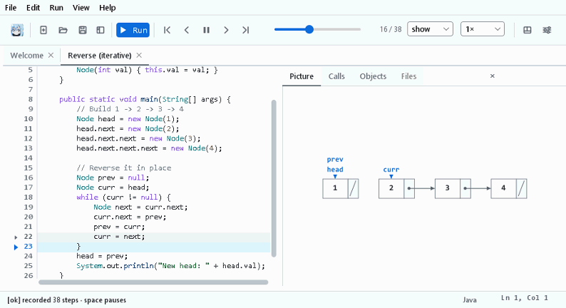
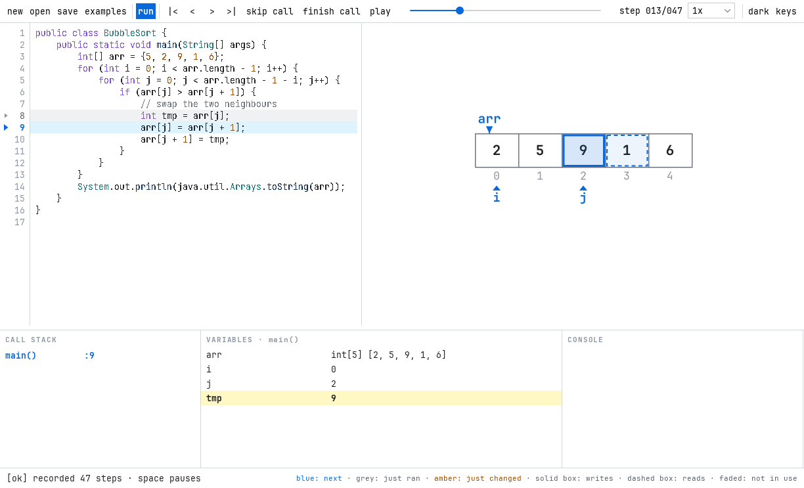
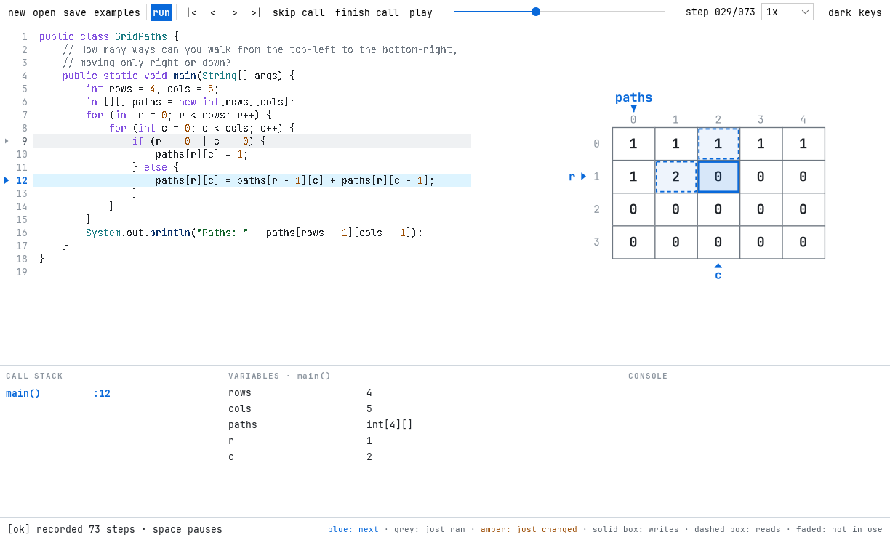
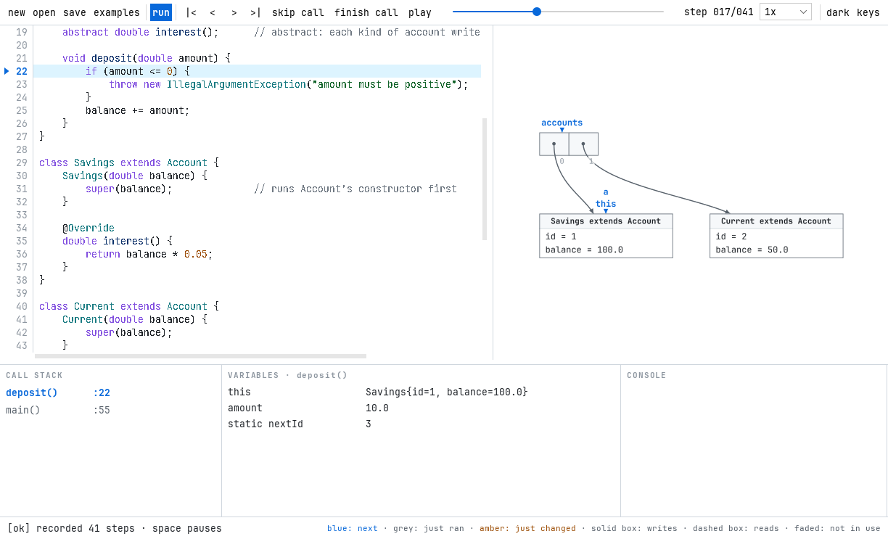
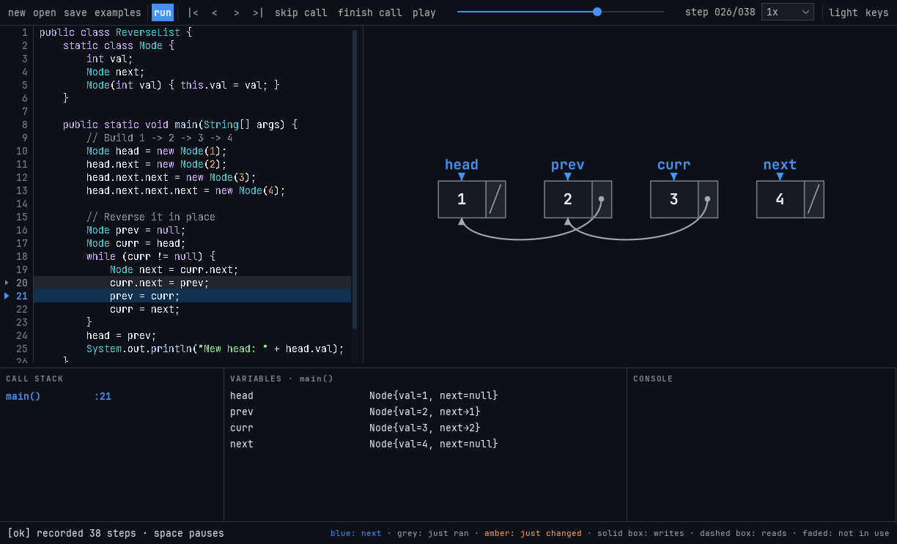
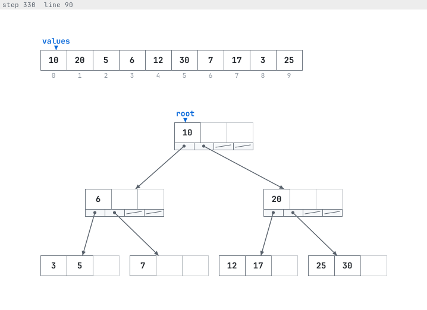
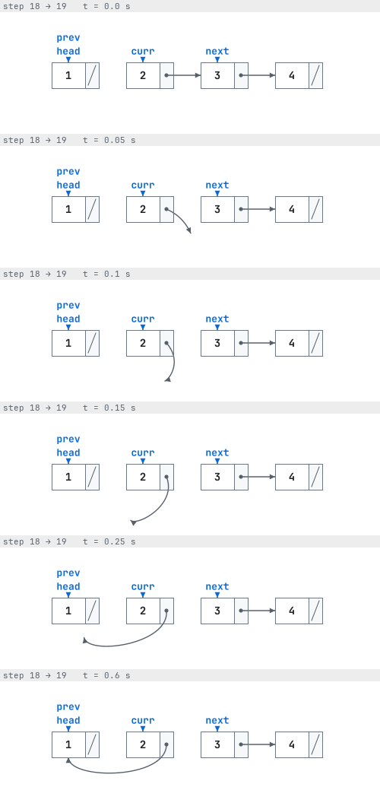

# Raphael

[](https://github.com/electricwhitener/raphael/actions/workflows/ci.yml)
[](https://github.com/electricwhitener/raphael/releases/latest)
[](LICENSE)

**See your Java program's data structures change while it runs.** Paste or open a Java program and press **Run**. Raphael records every line, then plays it back as a picture: arrays, linked lists, trees and objects, animated as each line changes them. Step forward and back through the whole run.



**[Download Raphael](https://github.com/electricwhitener/raphael/releases/latest)** for Windows, macOS or Linux. It's free, open source, and has its own Java inside, so there's nothing else to install.

It began as an object-oriented programming course project and is now an open-source tool. The [project report](docs/report/) explains how it works and where each OOP concept is used.

## What it does
- **Runs your own code.** Paste any single-file Java program. A `package` line and any number of classes are fine.
- **Records every line**, then plays it back. Step forward and back, drag a slider, skip over calls, or jump to a line.
- **Draws what's in memory:**
  - arrays and 2D grids
  - linked lists, doubly linked lists and binary trees
  - B-trees and tries
  - Java's collections (`ArrayList`, `Stack`, `LinkedList`, `HashMap`, `TreeSet`…)
  - any other object, as a box titled with its class and parent class (`Savings extends Account`)
- **Animates each change.** Nodes glide into place, arrows swing to new targets, copied values fly between cells, and changed values flash.
- **Marks what the next line will do:** `i` and `j` markers under array cells, and outlines on the cells it will read or write.
- **Explains problems.** Compile errors, crashes, missing input and infinite loops each get a clear message at the right line.
- **Works like a small IDE:** coloured code, undo, find, auto-indent, comment toggling, dark mode and adjustable text size.

| Bubble sort: `i`/`j` markers, one cell being written and one read | Grid DP: the cell being computed and the two cells it reads |
|---|---|
|  |  |

| OOP: boxes show inheritance | Dark mode |
|---|---|
|  |  |

A B-tree is drawn the way textbooks draw it: each node is a row of keys (faded past `n`), with its child pointers underneath. During a split, keys fly into the new node and the middle key flies up into the parent.



## Requirements and dependencies

**To run it, you need:**

| What | Version | Why |
|---|---|---|
| JDK | 21 | A full JDK, not just a JRE. Raphael compiles and debugs the code you give it, using the JDK's compiler and debugger. |
| Maven | 3.8 or newer | Downloads the libraries, and builds and tests the project. |

**Raphael's own dependencies.** Maven downloads the libraries; the font is in the repository.

| Dependency | Version | Used for | Licence |
|---|---|---|---|
| [FlatLaf](https://www.formdev.com/flatlaf/) | 3.5.4 | The modern look of the Swing window, light and dark | Apache 2.0 |
| [JUnit 5](https://junit.org/junit5/) | 5.11.4 | The tests only | EPL 2.0 |
| [JetBrains Mono NL](https://www.jetbrains.com/lp/mono/) | 2.304 | The font (`src/main/resources/fonts/`) | SIL OFL 1.1 |

**Parts of the JDK it relies on.** These need no separate install.

| Part | Used for |
|---|---|
| Swing and Java 2D (`java.desktop`) | The window and the drawing |
| `javax.tools` (`java.compiler`, `jdk.compiler`) | Compiling the code you give it |
| JDI, the Java Debug Interface (`jdk.jdi`, `jdk.jdwp.agent`) | Pausing your program at every line and reading its memory |
| `java.util.prefs` (`java.prefs`) | Remembering dark mode and text size |

Maven plugins: `maven-compiler-plugin` 3.13.0, `maven-surefire-plugin` 3.5.2, `exec-maven-plugin` 3.5.0.

## Getting started

### Install it
Raphael comes as an installer for each system, with its own Java inside, so there's nothing else to install.

| System | Download | Notes |
|---|---|---|
| Windows 10 and 11 | `Raphael-1.0.0-windows-x64.msi` | The installer isn't signed yet, so Windows may say "Windows protected your PC". Click **More info**, then **Run anyway**. |
| macOS, Apple Silicon | `Raphael-1.0.0-mac-arm64.dmg` | Not signed yet: the first time, right-click Raphael in Applications and choose **Open**. |
| macOS, Intel | `Raphael-1.0.0-mac-x64.dmg` | The same. |
| Ubuntu 24.04 and newer | `Raphael-1.0.0-linux-x64.deb` | `sudo apt install ./Raphael-1.0.0-linux-x64.deb` |
| Any other Linux | `Raphael-1.0.0-linux-x64.tar.gz` | Unpack it anywhere and run `Raphael/bin/Raphael`. |

They're all on the [latest release](https://github.com/electricwhitener/raphael/releases/latest) page. Raphael says in its status bar when a newer version is out (it checks once a day; you can turn that off in Settings).

### Build it yourself
You need JDK 21 and Maven 3.8 or newer. Every push runs the full test suite on fresh Windows, macOS and Linux machines (the badge above shows the result).

```bash
git clone https://github.com/electricwhitener/raphael.git
cd raphael
mvn test                       # optional: runs the tests
mvn -q compile exec:java       # opens the window
scripts/package.sh             # a ready-to-run folder in target/installer/Raphael
scripts/package.sh deb         # or an installer: msi on Windows, dmg on macOS, deb on Linux
```

`Raphael --self-test` (for example `target/installer/Raphael/bin/Raphael --self-test`) checks, with no window, that this copy can compile and record a program, and prints what it did.

**From Windows, with the project in WSL** (how it's developed): run `scripts/build-app.sh`, then copy `scripts/Run Raphael.bat` to your Desktop and double-click it. It expects the project at `~/raphael` in a WSL distribution called `Ubuntu`. Keep its black window open while you use Raphael. Run `scripts/build-app.sh` again after changing the code, because `dist/` is what the launcher runs.

## Using Raphael
1. **Choose a program.** Click an example in the guide that fills the picture area at first (or **Examples** in the toolbar), press **New** to type or paste your own (Ctrl+A then Ctrl+V replaces everything), **Open** a `.java` file with your system's own file dialog, or drop one onto the window.
2. **Give it input, if it needs some.** A **stdin** box appears when the code mentions `System.in`. Type the input there before running.
3. **Press Run** (Ctrl+Enter). The program plays by itself. While it's being recorded, the picture counts the steps and the button becomes **Stop**; stopping keeps the steps recorded so far.
4. **Move through the steps** with the keys below. Any manual move pauses playing. Click in the editor to type again.

**If something goes wrong.**
- Unsaved code is autosaved every 5 seconds. If Raphael doesn't close normally, it offers the code back the next time it starts.
- If Raphael itself hits a problem, it says so, and keeps the details in its log file:

| System | Log folder |
|---|---|
| Windows | `%LOCALAPPDATA%\Raphael\logs` |
| macOS | `~/Library/Logs/Raphael` |
| Linux | `~/.local/state/raphael/logs` |

The log never leaves your computer.

### Examples
| Example | Shows |
|---|---|
| BubbleSort | `i`/`j` markers, read and write outlines, values flying between cells |
| ReverseList | A linked list being reversed: the arrows swing and the nodes stay put |
| BSTInsert | Recursion building a binary search tree |
| FibDP | A 1D dynamic programming table filling in |
| GridPaths | A 2D dynamic programming table, and the cells each line reads |
| BuggyList | A bug you can see: the rest of a list being lost |
| OffByOne | A crash: an index walks past the end of an array |
| BTreeInsert | A B-tree, with keys moving during a split |
| BankAccounts | OOP: an interface, an abstract class, inheritance, polymorphism and a caught exception |

### Keyboard shortcuts
Every command is also in the menus (File, Edit, Run, View, Help), with its shortcut beside it. The **?** button (or F1) shows the keys in the app. On a Mac, use Cmd where this table says Ctrl, and Option where it says Alt; the app shows the Mac names there.

| Keys | Action |
|---|---|
| Ctrl+Enter or F5 | Run; while recording, stop |
| Esc | Pause, or stop recording |
| Space | Play or pause |
| Right, Left | Step forward, back (hold Alt when in the editor) |
| Home, End | First, last step |
| Alt+Down, Alt+Up | **skip call** (don't go inside calls on this line), **finish call** (run until this method returns) |
| Click a line number | Jump to the next time that line runs |
| Ctrl+N, Ctrl+O, Ctrl+S | New, open, save (open and save use your system's own file dialog) |
| Ctrl+Shift+S | Save as |
| Ctrl+Z, Ctrl+Y | Undo, redo |
| Ctrl+F, F3 | Find, find next |
| Ctrl+/ | Comment or uncomment lines |
| Tab, Shift+Tab | Move lines in, out |
| Ctrl + and Ctrl - | Text size (or Ctrl + wheel over the code) |
| Ctrl + wheel over the picture | Zoom the picture |
| Ctrl+0 | Normal text size and zoom |
| Ctrl+D | Dark or light |
| Ctrl+, | Settings: step limit, timeout, memory, text size, theme (System, Light or Dark) |
| F6, Shift+F6 | Move the keyboard between the toolbar, the code and the picture |
| Ctrl+Q | Quit (on a Mac, Cmd+Q) |

### Reading the picture
The status bar has a key to these: a swatch for each mark, from "Next" to "Reads".

- **Blue means "about to happen".**
  - The line that runs next is blue, with a ▶ in the gutter.
  - Variable names like `curr` point at their objects.
  - Index markers like `i` and `j` sit under array cells.
  - The cells the next line will **write** get a blue tint and a solid outline, and the ones it will **read** a paler tint and a dashed one.
- **Grey marks the line that just ran.** The picture shows the state after that line.
- **Amber means "one step just changed this".** A changed value flashes and keeps a soft glow. Changed variables and newly printed output are tinted amber too. A jump with the slider or Home and End doesn't flash.
- **Red means an error.** A red banner says what happened: a compile error, a crash or missing input. The line turns red. An index past the end of an array shows as a red ghost cell, if the run really crashes there.
- **Faded means not in use.** An index just outside an array (-1, or the length, often why a loop stops) gets a faded ghost cell. A B-tree key past `n` is faded. An object still being constructed is a faded `new` cell.
- **A dot in a slot is a reference**, and its arrow shows what it points at. A slash means `null`.

### Limits
- The program must be one file with a `public static void main(String[] args)`.
- A step is one line, so `for (...) sum += a[i];` written on one line runs as one step. Put one statement on each line to see each one.
- A run stops after 2,000 steps (change it in **settings**), so keep inputs small. This is also what ends an infinite loop, and a recursion with no base case, which Raphael names.
- A program that does nothing for 5 seconds is stopped, which includes a long `Thread.sleep` (**settings** allows up to 60).
- Each step keeps at most 300 objects, 64 cells per array and the newest 32 method calls.
- A program may use at most 256 MB of memory (**settings** allows up to 2 GB). More than that ends it with an `OutOfMemoryError`.
- Java's other classes (`Scanner`, `Random`…) appear by name only.
- Recording is quick for typical programs (building a 500-node list, 2,000 steps, takes about 2 seconds). A long run can still take a while: the status bar counts the steps, and **stop** keeps what's recorded.

## How it works

```
editor text
   │  SourceCompiler.compile()      javac with -g, into a temp folder
   ▼
CompileResult                       .class files, errors, the class that has main
   │  JdiTracer.trace()             runs it in a second JVM, breakpoint on every line
   ▼
Trace = [Snapshot, Snapshot, …]     one Snapshot per line run: call stack, variables, objects
   │  StructureDetector.detect()    array? grid? linked list? tree? box?
   ▼
Structures
   │  SceneBuilder.build()          renderers lay out shapes; IndexUsage adds i/j markers and outlines
   ▼
Scene per step                      shapes with stable keys ("#12", "#7[2]", "var:curr")
   │  Animator + ScenePainter       springs move every shape to its new place; Java 2D draws it
   ▼
VisualPanel in the window           every panel follows the TraceModel (Observer pattern)
```

1. **Compile.** `SourceCompiler` saves the editor's text to a temp folder and calls the JDK's compiler (`javax.tools.JavaCompiler`) with `-g`, so variable names are kept. Errors come back with their line numbers. Pasted code has no file name of its own, so the file rules don't apply to it: the top-level `public` and `package` are replaced by spaces in the copy javac sees. The same number of spaces keeps every line number right.
2. **Trace.** `JdiTracer` starts the program in a second JVM in debug mode, using JDI (Java Debug Interface). It puts a breakpoint on every line of the student's classes, so the program pauses before each line. Java's own classes are skipped.
3. **Snapshot.** At every pause, `HeapReader` copies the program's state into a `Snapshot`. It starts from the local variables and static fields and follows every reference to the objects behind them (a breadth-first search). Every Java collection can list its items with `toArray()`, whichever way it stores them, so `HeapReader` calls that inside the paused program and stores the result as an ordinary array, which is then drawn like any other. (`ArrayList`, `Vector` and `Stack` are read straight from their fields, which is quicker.) Reading an object is a round trip to the paused program, so `HeapReader` remembers the student's objects between steps. JDI reports every write to their fields, and only the objects that were written are read again.
4. **Rewind.** The `Trace` keeps every `Snapshot`, so stepping back just means showing the previous one (the Memento pattern). An object that didn't change is shared by the snapshots instead of copied.
5. **Recognise.** `StructureDetector` looks at each class's fields:
   - one field of its own type (`Node next`) → linked list
   - `prev`/`next` → doubly linked list
   - `left`/`right` → binary tree
   - an array of its own type (`Node[] children`) → multi-way tree, like a B-tree
   - an array of arrays → grid
   - anything else → box

   `IndexUsage` reads the program's text to find array indexes: `arr[j + 1]` means `j` indexes `arr`, and `paths[r][c]` means `r` indexes rows and `c` columns. It also finds which cells each line reads and writes.
6. **Lay out.** `SceneBuilder` first measures the whole run, so widths and spacing never jump between steps. Then it asks each structure's renderer to place its shapes:
   - array cells in a row; small arrays share a row, and each keeps room for its longest length
   - list nodes left to right; each node keeps its place for the whole run, so a reversal flips the arrows instead of moving nodes
   - tree nodes by in-order position and depth
   - B-tree nodes as rows of keys, with leaves side by side and each parent centred over its children
   - other objects as boxes, titled with the class and its parent (`Savings extends Account`), with each field a shape of its own so only a changed field flashes

   It also adds the variable labels, the `i`/`j` markers and the read/write outlines.
7. **Animate.** Every shape is pulled to its new place by a spring (`Spring`): `x(t) = target + (a + b·t)·e^(−ω·t)`.
   - The spring is critically damped, so it never overshoots.
   - It keeps its speed when a new step changes its target, so fast stepping flows.
   - An arrow whose target changed swings around its start like a clock hand.
   - A pointer set to `null` pulls back into its slot.
   - A value copied between cells (`arr[j] = arr[j + 1]`) flies across.
   - Text is drawn as glyph outlines at exact fractional positions, so it doesn't wobble while moving.
8. **Window.** `MainWindow` runs steps 1–6 on a background thread (`SwingWorker`), so the window never freezes. `TraceModel` holds the current step and tells every panel when it changes. `VisualPanel` centres the picture and scales it to fit, using one scale and offset for the whole run, so it never jumps between steps.

Safety:
- at most 2,000 steps, so infinite loops end
- a 5-second limit if the program stops responding
- only the newest 32 method calls are read at each step, so recursion with no base case still ends quickly
- a stop button, with a live count of the steps recorded
- output read on separate threads, so the program never blocks
- an uncaught exception shown as the last step
- at most 256 MB of memory for the program (`-Xmx256m`)
- the program never outlives Raphael: a shutdown hook ends it when Raphael quits, and a small Java agent inside it (`ParentWatch`) ends it if Raphael is killed



## File map

| File | Job | Key methods |
|---|---|---|
| `SelfTest` | `Raphael --self-test`: compiles and records an example with no window, for checking the installers | `run()` |
| `App` | Starts the app: the log, the safety net, the look and the saved settings, then the main window; or the self-test | `main()`, `setupLook()`, `setupLook(dark)` |
| `RaphaelException` | Abstract parent of every problem Raphael can explain (checked) | constructors |
| **compile/** | | |
| `SourceCompiler` | Compiles the editor's text with javac and finds the class with `main`; blanks the file rules first | `compile(source)`, `topLevelText()`, `withoutFileRules()` |
| `CompileResult` | The result: success, errors (line + message), class folder, main class | record getters |
| `CompileSetupException` | Raphael couldn't get ready to compile: no JDK, or the temp folder can't be written | constructors |
| **trace/** | | |
| `Tracer` | Interface: "run this program and record every step" | `trace(program, input)`, `trace(program)`, `stop()`, `stepsSoFar()` |
| `JdiTracer` | Runs the program with JDI: breakpoints, events, step limit, exceptions | `trace()`, `launch()`, `Run.handleEvents()`, `Run.classLoaded()`, `Run.lineReached()`, `Run.crashed()`, `stop()` |
| `HeapReader` | Copies the paused program's memory into a `Snapshot` (BFS); remembers unchanged objects; asks a collection for its items | `capture()`, `fieldWritten()`, `stopRemembering()`, `readListFields()`, `readFrames()`, `readStatics()`, `readObject()`, `readCollection()`, `call()`, `toValue()` |
| `OutputDrainer` | A thread that copies the program's printed output into a buffer | `run()` |
| `TraceLimits` | Safety limits (2,000 steps, object and cell caps, timeout, memory) | constants |
| `RunLimits` | The limits the user can change: steps, timeout, memory; refuses values out of range | record, `DEFAULTS` |
| `ParentWatch` | A Java agent inside the student's program that ends it if Raphael is killed; writes its own agent jar | `premain()`, `jar()` |
| `TraceException` | The program couldn't be traced (a `RaphaelException`) | constructor |
| **io/** | | |
| `AppFolders` | Where Raphael keeps its files on each system | `data()`, `logs()` |
| `AppLog` | The log file: java.util.logging, 3 files of 1 MB, one line per message | `setup()`, `folder()`, `LineFormatter.format()` |
| `SafeFiles` | Saving that never leaves a half-written file; reading that refuses huge or binary files; plain reasons for file errors | `write()`, `readCode()`, `describe()` |
| `DraftStore` | The autosaved draft | `save()`, `load()`, `clear()` |
| `UpdateCheck` | Asks GitHub, at most once a day, whether a newer Raphael exists | `newer()`, `isNewer()`, `currentVersion()` |
| **model/** | | |
| `Value` → `PrimitiveValue`, `ReferenceValue`, `NullValue` | What a variable, field or array cell holds: `5`, `#12` or `null` | `display()` |
| `HeapObject` → `ObjectNode`, `ArrayNode` | An object in memory: one with fields, or an array (or a collection) | `describe(snapshot)`, `shortName()`, `getFields()`, `getElements()` |
| `FrameSnapshot` | One running method: its name, line and local variables | getters |
| `Snapshot` | Everything at one pause | `getLine()`, `getFrames()`, `getHeap()`, `getObject(id)` |
| `Trace` | The whole run: snapshots, output, why it ended | `size()`, `get(step)`, `getOutputAt(step)`, `getEndReason()` |
| `EndReason` | Finished, step limit, exception, timeout or stopped | enum |
| `Names` | Shortens type names: `Main$Node` → `Node`, a lambda's hidden class → `lambda` | `simple(name)` |
| **detect/** | | |
| `StructureDetector` | Decides what each object is (array, grid, list, tree or box) from its fields' types and names | `detect(snapshot)`, `shapeOf()`, `buildTrees()`, `buildGrid()` |
| `IndexUsage` | Reads the code: which variables index which arrays (also `x.keys[i]` and `keys[j + T]`), and which cells a line reads or writes | `rowVariables()`, `columnVariables()`, `accessesOnLine()`, `accessesIn()` |
| `Structure` | Abstract parent of every drawable structure | `getObjectIds()`, `getKind()`, `contains(id)` |
| `ArrayStructure`, `GridStructure`, `GenericStructure` | An array, a 2D array, and any other object (a box) | getters |
| `LinkedStructure` | Abstract parent of lists and trees: nodes, links, node text | `follow()`, `getLabel(id)`, `labelOf()` |
| `LinkedListStructure` | All nodes of one list class, as chains from each head | `getChains()`, `getNext(id)`, `getPrev(id)` |
| `BinaryTreeStructure` | One tree: its root and left/right links | `getRoot()`, `getLeft(id)`, `getRight(id)` |
| `MultiwayTreeStructure` | A tree whose children are in an array (a B-tree): keys, children, count | `getChildren(id)`, `getKeysArray(id)`, `getUsedKeys(id)` |
| **render/** | | |
| `SceneBuilder` | Learns the whole run (sizes, markers, list order), then builds any step's `Scene`: lays out structures in rows, adds markers, outlines, labels and moves | `build(trace)`, `rowOf()`, `markersAt()`, `addFocus()`, `addMoves()`, `addLabels()` |
| `RenderContext` | What renderers share: list order, fixed widths for the run, this step's markers | `cellWidth()`, `nodeWidth()`, `markersFor()` |
| `StructureRenderer` | Abstract parent of the renderers; its factory picks the right one | `render(scene, x, y)`, `forStructure()`, `addMarkers()` |
| `ArrayRenderer`, `GridRenderer` | A row of cells with indexes and markers; a table with row/column numbers and markers | `render()` |
| `LinkedListRenderer` | `[ value \| • ]→` boxes in a row; null is a slash | `render()` |
| `BinaryTreeRenderer` | x = in-order position, y = depth | `render()`, `walk()` |
| `MultiwayTreeRenderer` | A B-tree: rows of keys, child pointers underneath, parents centred over children | `render()`, `place()`, `drawNode()` |
| `BoxRenderer` | Any other object: class name, then one line per field | `render()`, `linesOf()`, `widthOf()` |
| `ListOrder` | Remembers each list node's left-to-right place for the whole run, and the step it got it | `learn()`, `showStep()`, `arrange()` |
| `SceneList` | The run's pictures, each built when first shown; keeps the 64 most recent | `get(step)`, `getRunSize()` |
| `Scene`, `SceneNode`, `SceneEdge` | The shapes, arrows and copied values of one step, with stable keys and a "look" for animation | `add()`, `getNode(key)`, `getEdge(key)`, `getSize()` |
| `ScenePainter` | Draws a `Scene` with Java 2D: outline text, Bézier arrows that bend and swing, then the dots on top of their slots | `paint(g, scene)`, `route()`, `paintArrowStart()` |
| `Spring` | One number pulled to its target by a critically damped spring | `step(dt, omega)`, `setTarget()` |
| `Animator` | Keeps every shape "live" and moves it with springs; fades, flashes, swings arrows, flies values | `animateTo()`, `jumpTo()`, `show()`, `advance()` |
| `Diff` | What changed between two scenes: added, removed, moved, changed | `between(before, after)` |
| `Style` | Every colour, size, font and timing; swaps all the colours for dark mode; loads the bundled font | constants, `useTheme(dark)`, `setCodeSize()`, `textWidth()`, `pickMono()` |
| **ui/** | | |
| `MainWindow` | The window: toolbar, panels, shortcuts, and run on a background thread | `run()`, `show()`, `bindKeys()`, `newProgram()`, `loadExample()`, `open()`, `save()`, `saveAs()`, `chooseFile()`, `updateTitle()`, `dividerForCode()`, `okToLoseCode()`, `startFolder()`, `toggleTheme()`, `applyTheme()`, `changeTextSize()`, `find()`, `showHelp()` |
| `TraceModel` | Holds the run and the current step; tells listeners when it changes | `load()`, `setStep()`, `next()`, `stepOver()`, `stepOut()`, `jumpToLine()`, `getRunSize()` |
| `TraceListener` | Interface every panel implements to hear about step changes | `stepChanged()`, `traceChanged()` |
| `CodePanel` | Editor with colours, clickable line numbers, next/previous-line marks, error marks and undo | `showErrors()`, `stepChanged()`, `undo()`, `isDirty()`, `widthForLongestLine()`, `pasteHere()`, `ColoredView.drawUnselectedText()` |
| `EditorKeys` | What a code editor does for you: keeps the indentation, moves lines with Tab, comments with Ctrl+/, finds text | `install()`, `newLine()`, `indent()`, `toggleComment()`, `find()` |
| `JavaTokens` | Splits code into the pieces that get a colour: comments, strings, numbers, keywords, types, methods | `of(code)` |
| `VisualPanel` | Shows the animated picture: centred and scaled to fit, plus zoom | `stepChanged()`, `paintComponent()`, `fitToRun()`, `zoomBy()`, `setMessage()`, `banner()` |
| `ControlsBar` | Step buttons, skip call and finish call, slider, play and speed; a step made by hand pauses playing | `stepChanged()`, `togglePlay()`, `play()` |
| `CallStackPanel`, `LocalsPanel`, `ConsolePanel` | Running methods; variables (changed ones tinted); output (new output tinted) and a stdin box that appears when needed | `stepChanged()`, `showInput()` |
| `Section` | Terminal-style section headers and thin borders | `header()`, `wrap()`, `hairline()` |
| `Legend` | The key to the picture's marks in the status bar: a swatch and a name for each | `paintComponent()` |
| `Icons` | The toolbar's icons, drawn with Java 2D; each `Glyph` (an enum) draws itself | `of(glyph, role)`, `Glyph.draw()` |
| `Dialogs` | One look for every question and message, with buttons in each system's order (Builder pattern) | `question()`, `tell()`, `Question.ask()`, `order()` |
| `EmptyState` | The guide in the picture area before the first run: three steps and example chips | constructor |
| `FileDrop` | Opens a `.java` file dropped onto the window; wraps the editor's own copy and paste | `canImport()`, `importData()` |
| `WindowsFileDialog` | Inside WSL, shows Windows' own Open and Save dialog through PowerShell | `available()`, `choose()`, `script()` |
| `Logo` | The app icon, drawn with Java 2D; the window and the installers use it | `draw(size)`, `windowIcons()` |
| `Shortcuts` | The shortcut key on this computer: Ctrl, or Cmd on a Mac; the key names shown to the user | `key()`, `label()`, `isDown()` |
| `SystemTheme` | Whether the computer is in dark mode, for the first launch | `isDark()`, `isDarkAnswer()` |
| `ErrorReporter` | The safety net: logs any problem nothing caught and tells the user | `install()`, `report()`, `details()` |
| `SettingsDialog` | The settings window: run limits, text size, and a System / Light / Dark theme switch | `ask()`, `read()` |
| **resources/examples/** | The nine example programs in the examples menu | — |
| **resources/fonts/** | The JetBrains Mono NL font files and their licence | — |

## OOP concepts

This table lists where each concept is used. [Chapter 5 of the report](docs/report/05-oop-and-design.md) goes through the main ones with the code.

Each class also names its concept in an `// OOP:` comment at the top of the file.

| Concept | Where | In one sentence |
|---|---|---|
| Encapsulation | `TraceModel` (`setStep` keeps the step valid), `Spring`, `Snapshot`, `Trace`, `HeapObject`, `Animator` | Fields are private, read through getters, and changed only through methods that check them, so nothing can be put in an impossible state. |
| Abstraction | `Tracer`, `RaphaelException`, `HeapObject`, `Structure`, `LinkedStructure`, `StructureRenderer` | The window asks a `Tracer` for a `Trace` without knowing about JDI; abstract classes like `Structure` can't be created themselves, only their concrete kinds. |
| Interfaces | `Tracer` (`stop()`, `stepsSoFar()` and `setLimits()` are default methods), `Value`, `TraceListener` (with a default method) | `JdiTracer` implements `Tracer`; the three value kinds implement `Value`; all six panels implement `TraceListener`. |
| Composition | `MainWindow` is made of panels; `EditorKeys` holds a text area; `Animator` holds `Spring`s | One object is built from others and hands them work, instead of inheriting from them. |
| Inheritance | `CodePanel.ColoredView` extends Swing's `PlainView`; `ObjectNode`/`ArrayNode` extend `HeapObject`; the six renderers extend `StructureRenderer`; the panels extend `JPanel`; `MainWindow` extends `JFrame`; `OutputDrainer` extends `Thread`; `RaphaelException` extends `Exception`, and `TraceException` and `CompileSetupException` extend it; `AppLog.LineFormatter` extends Java's `Formatter`; `SettingsDialog` extends `JDialog`; `SceneList` extends `AbstractList`, so it's a `List<Scene>` to everyone else | Subclasses reuse the parent's fields and methods and add their own. |
| Multilevel inheritance | `Structure` → `LinkedStructure` → `LinkedListStructure` / `BinaryTreeStructure` / `MultiwayTreeStructure` | Lists and trees share node handling in the middle class; each adds its own links. |
| Polymorphism (overriding) | `render()`, `describe(snapshot)`, `shortName()`, `display()`, `drawUnselectedText()`, `getKind()`, `stepChanged()`, `paintComponent()`, `OutputDrainer.run()`, `LineFormatter.format()` | The same call does the right thing for each kind of object: `SceneBuilder` calls `render()` without knowing which renderer it has, and `TraceModel` calls `stepChanged()` without knowing which panel it is. |
| Polymorphism (overloading) | `App.setupLook()` / `setupLook(dark)`; the two `ObjectNode` constructors; `Tracer.trace(program)` / `trace(program, input)`; `Scene.add(SceneNode)` / `add(SceneEdge)` / `add(Move)`; the two `SceneNode` and `SceneBuilder` constructors; `Shortcuts.key(spec)` / `key(spec, mac)` | Same name, different parameters. |
| Exception handling | a family of checked exceptions under the abstract `RaphaelException`, each keeping its cause; `MainWindow.runFailed()` tells expected problems from bugs; `ErrorReporter` catches what nothing else did, on every thread; `SafeFiles.describe()` turns `NoSuchFileException` and `AccessDeniedException` into plain reasons; try-with-resources in `SourceCompiler` and `OutputDrainer`; `ExecutionException` caught in `MainWindow`; multi-catch and `finally` in `SystemTheme.run()`; try-with-resources over two streams in `ParentWatch.jar()` | A custom checked exception, resources that close themselves, and background errors shown to the user. |
| Threads | `OutputDrainer`, `SwingWorker` in `MainWindow`, Swing `Timer` in `Animator` and `ControlsBar`, the shutdown hook in `JdiTracer` | Output is read on separate threads, tracing runs in the background, and timers drive play and the animation. |
| Nested and anonymous classes | `Animator.LiveNode` / `LiveEdge` / `Flyer`, `ScenePainter.Curve`, `JdiTracer.Run`, `CodePanel.LineNumbers` / `ColoredView`; the `SwingWorker` in `MainWindow.run()` and the cell renderers in the panels | Helpers that only make sense inside their outer class. |
| Static members | `TraceLimits`, `Style`, `Names`, `Section`, `Shortcuts`, `SystemTheme`, `ParentWatch`, `AppFolders`, `AppLog`, `SafeFiles`, `ErrorReporter`, `JavaTokens`, `NullValue.INSTANCE`, `Diff.between()` | Constants, utility classes, a single shared object (singleton) and a static factory method. |
| Records and enums | `Icons.Glyph` (an enum whose constants each override `draw()`), `SettingsDialog.Theme`, `CompileResult`, `RunLimits` (its compact constructor checks the ranges), `SettingsDialog.Values`, `SceneNode` (+ `Look`), `SceneEdge`, `Scene.Move`, `IndexUsage.Access`, `RenderContext.Marker`, `EndReason`, `SceneNode.Kind` | Small unchangeable data classes, and fixed sets of named values. |
| Design pattern: Observer | `TraceModel` and `TraceListener` | Panels register with the model and are told when the step changes; they never talk to each other. |
| Design pattern: Memento | `Trace` and `Snapshot` | Saved copies of the program's state, so stepping back is just showing an earlier copy. |
| Design pattern: Builder | `Dialogs.question(...).body(...).buttons(...).ask()` | Builds a dialog step by step, so its many optional parts don't need one method with a dozen parameters. |
| Design pattern: Decorator | `FileDrop` wraps the editor's `TransferHandler` | Adds dropping files, and passes copy and paste on to the handler it wraps. |
| Design pattern: Factory | `StructureRenderer.forStructure()` | One method decides which renderer class to create, so no one else has to. |
| Packages | `compile`, `trace`, `model`, `detect`, `render`, `ui`, `io` | One package per job. |

## Tests

`mvn test` runs 213 JUnit 5 tests, on Windows, macOS and Linux in CI. JaCoCo measures coverage while they run (`target/site/jacoco/index.html`): 78.5% of lines and 70.5% of branches.
- `ExamplesTest`: every program in the examples menu runs to its expected end.
- `EdgeCaseTest`: 32 tricky programs in `src/test/resources/edge/`, each saying at its top what must happen (threads, `System.exit`, unicode, cycles, running out of memory or input, a recursion with no base case, Windows line endings…). Every step of each is also laid out and drawn.
- `SoakTest` (not part of a normal `mvn test`): every example run 100 times, and every run must take the same steps. It runs every night in CI, or with `mvn test -Dgroups=soak -DexcludedGroups=`.
- `SourceCompilerTest`: good code compiles; a missing `;` is reported on the right line; the class with `main` is found; a missing `main` is reported; a `package` line, `public final` and other public types, several public classes, "class" in a comment or string, and invisible web characters all work; line numbers stay right.
- `TracerTest`: a loop's exact line path, `while(true)` stopping at 2,000 steps, an uncaught exception as the last step, `Scanner` input, a captured linked list, recursion with no base case (named in the message), pressing stop, Java's collections, an enum's name, a student's own collection class, no program left running after Raphael quits or is killed, and the step limit from settings.
- `HeapObjectTest`: the text in the variables panel, with no ids: arrays, grids, references, and objects that weren't captured.
- `RememberingTest`: 38 programs recorded twice, once remembering unchanged objects and once reading everything, give the same steps; a 500-node list reads each node about once.
- `SceneListTest`: a step's picture is the same however the user got there: forwards, backwards, or built again after the cache let it go.
- `NamesTest`: short type names, including lambdas.
- `StructureDetectorTest`: array, grid, list, half-reversed list, doubly linked list, tree, B-tree, box, a cycle that doesn't hang, and a count field found on a Turkish-language computer.
- `IndexUsageTest`: which variables index which arrays, reads vs writes, `x.keys[i]` and `keys[j + T]`, constants and comments.
- `SceneBuilderTest`:
  - list nodes keep their places across a reversal
  - tree layout
  - labels above their objects
  - `i`/`j` markers and read outlines
  - copies remembered as moves
  - the ghost cell past the end of an array
  - a B-tree with parents centred over their children
  - red only for a real crash, ghost cells at -1 and the length
  - arrays on top and sharing rows, room kept for them, unlinked nodes beside their tree, markers only where the array is in use
  - `new` cells, tries, lists of lists as tables, named values
- `SpringTest`: arrives without overshooting, keeps its speed when retargeted, same motion at any frame rate.
- `AnimatorTest`:
  - the diff
  - gliding without overshoot
  - fading in and out
  - changed values rolling and glowing
  - arrows swinging
  - copied values flying
- `ScenePainterTest`: a pointer slot's dot is drawn on top of the slot, and an arrow from a tree node doesn't cover its value.
- `StyleTest`: the bundled font loads and has the symbols Raphael uses; dark mode swaps the colours and stays readable (measured contrast); text size stays within limits.
- `TraceModelTest`: the step stays in range, listeners hear each change once, step over, step out, jump to line, clearing, speed checks, the size of a run's biggest picture.
- `CodePanelTest`: undo and redo, undo locked during a run, the unsaved flag, the width of the longest line.
- `EditorKeysTest`: indentation, the closing brace, Tab and Shift+Tab, comments, find.
- `JavaTokensTest`: each kind of colour, words inside comments and strings, unfinished text while typing, very long strings.
- `ControlsBarTest`: a step made by hand pauses playing.
- `MainWindowTest`: no panel around the picture takes the shortcut keys for itself.
- `ShortcutsTest`: Ctrl becomes Cmd and Alt becomes Option on a Mac, in the keys and in the text; the keys screen stays in two columns.
- `SystemThemeTest`: the dark-mode answers of Windows, macOS and Linux are read correctly, and asking never fails.
- `ErrorReporterTest`: an exception nothing caught, on another thread, ends up in the log; the details have the versions and the stack trace.
- `SettingsDialogTest`: the dialog hands back what it was opened with.
- `RunLimitsTest`, `RaphaelExceptionTest`: limits out of range can't exist; Raphael's exceptions are one family and keep their cause.
- `AppFoldersTest`, `AppLogTest`, `SafeFilesTest`, `DraftStoreTest`: the right folders on each system; the log's line format; no half-written files, refusing huge or binary files, plain reasons; the draft saved, read and cleared.

## Project documents and scripts

| File | What it is |
|---|---|
| [CHANGELOG.md](CHANGELOG.md) | What changed in each version |
| [PRIVACY.md](PRIVACY.md) | What Raphael stores and sends |
| [CONTRIBUTING.md](CONTRIBUTING.md) | Reporting bugs, building and testing |
| [DECISIONS.md](DECISIONS.md) | Why things were built the way they were, stage by stage |
| [ROADMAP.md](ROADMAP.md) | Version 2: the stages that turn Raphael into a product |
| [docs/report/](docs/report/) | The project report, one chapter per file (a draft that grows with the roadmap) |
| [CLAUDE.md](CLAUDE.md) | Project notes and instructions for Claude Code, the AI coding assistant used to build Raphael |
| `.claude/agents/raphael-design-critic.md` | The design reviewer agent used during development |
| `scripts/package.sh` | Builds the private Java runtime (`jlink`) and an installer (`jpackage`) for this system |
| `scripts/AppIcon.java` | Writes the app icon in each system's format (`.ico`, `.icns` set, `.png`) |
| `.github/workflows/package.yml` | Builds every installer, installs it on a fresh machine, runs `--self-test`, and takes screenshots |
| `scripts/build-app.sh` | Packages the app into `dist/` |
| `scripts/Run Raphael.bat` | Starts `dist/` from Windows through WSL |

## Licence
Raphael is free and open source, under the [MIT License](LICENSE).

The bundled fonts are under the SIL Open Font License: JetBrains Mono NL (`src/main/resources/fonts/OFL.txt`) and Inter (`src/main/resources/fonts/Inter-OFL.txt`). FlatLaf and JUnit keep their own licences, listed above.

Raphael keeps your code on your computer; see [PRIVACY.md](PRIVACY.md). To report a problem or suggest an idea, see [CONTRIBUTING.md](CONTRIBUTING.md).
