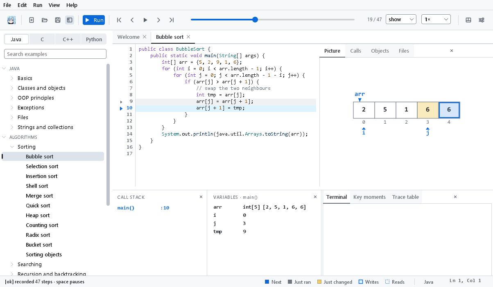
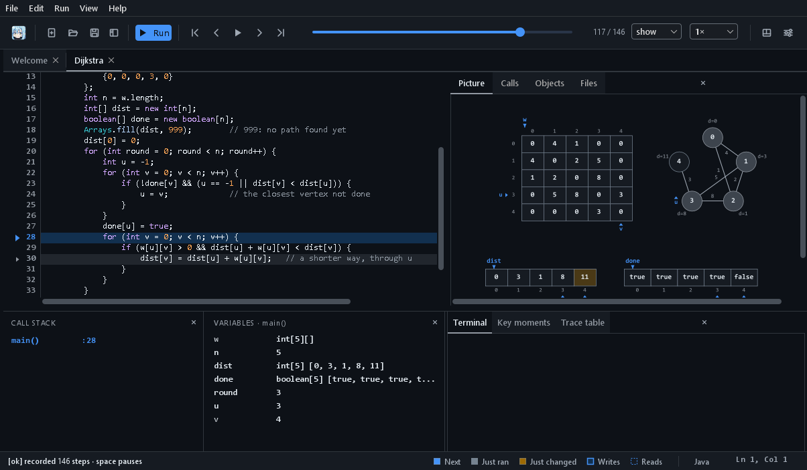
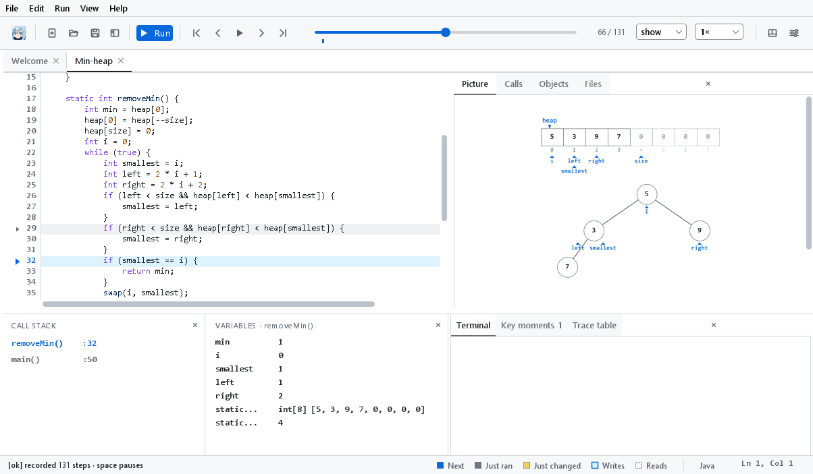
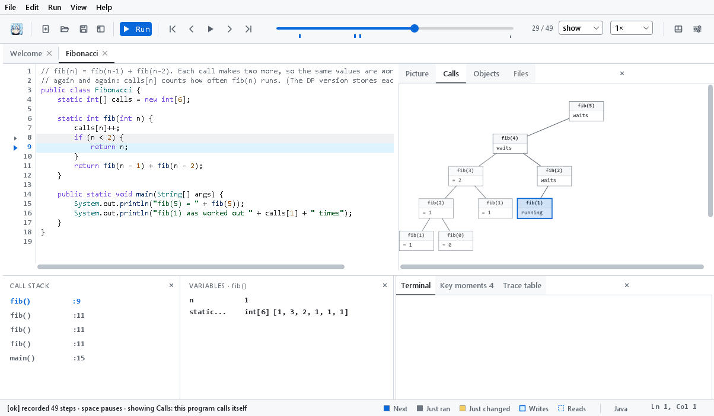
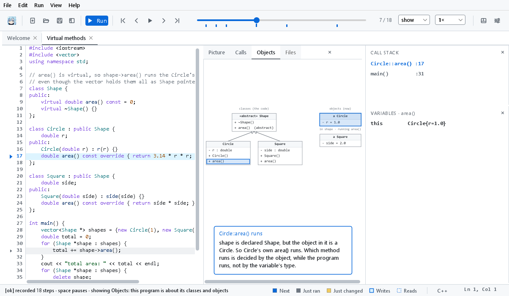
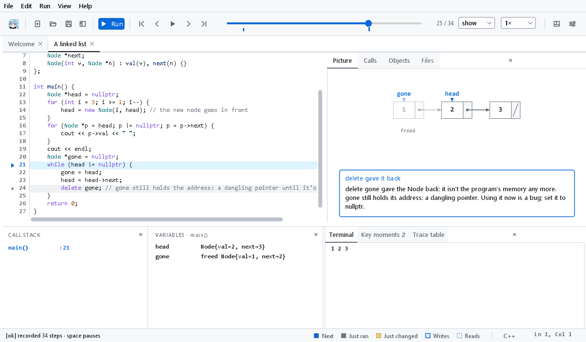
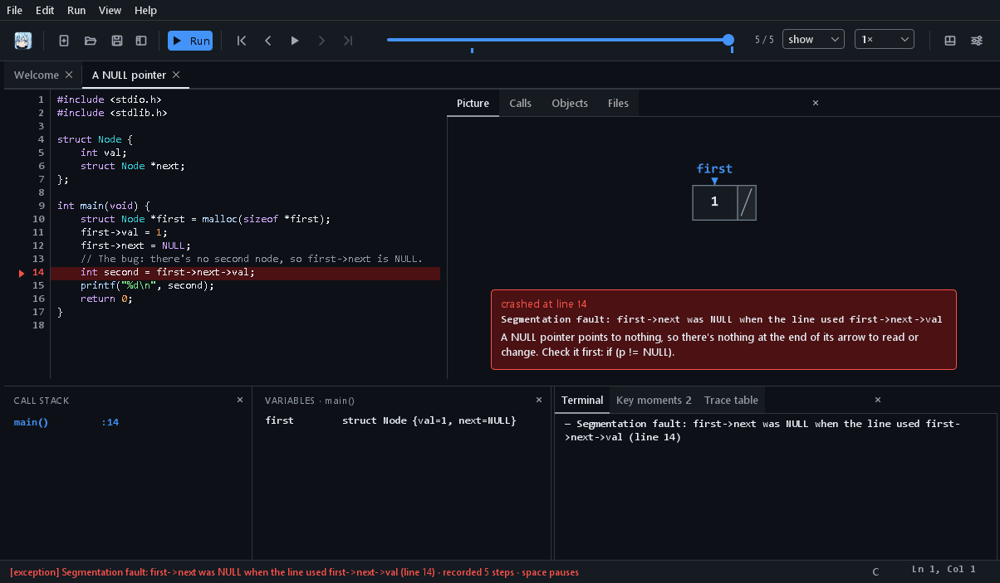
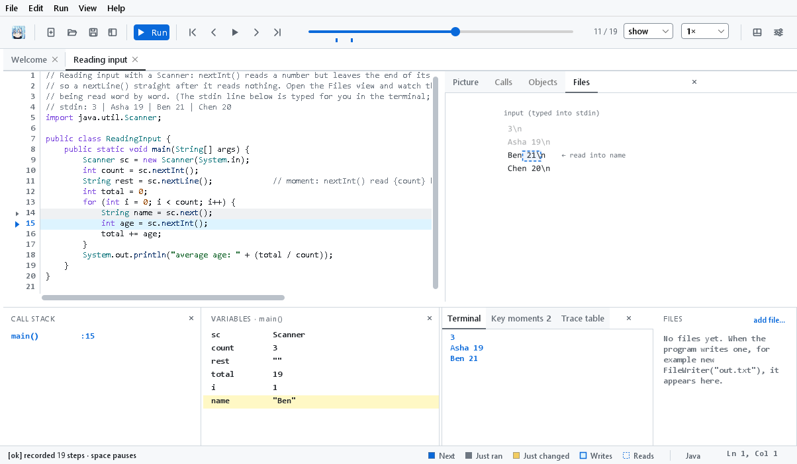
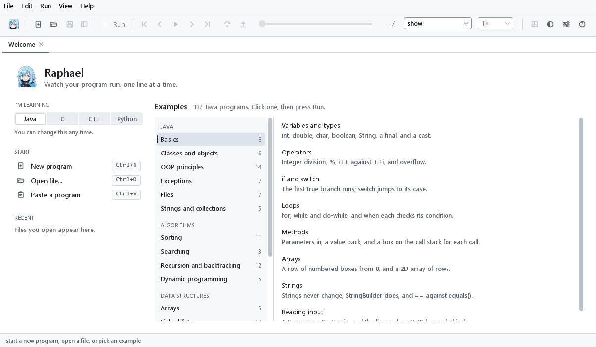

# Raphael

[](https://github.com/electricwhitener/raphael/actions/workflows/ci.yml)
[](https://github.com/electricwhitener/raphael/releases/latest)
[](LICENSE)

**Watch your program think.** Raphael is a free desktop app that runs your Java, C or C++ program one line at a time and draws what is happening inside it: the arrays, the linked lists, the trees, the objects. Then it plays the whole run back like a film, forwards and backwards, so you can see exactly what each line did.

**[Download Raphael](https://github.com/electricwhitener/raphael/releases/latest)** for Windows, macOS or Linux.


## Why it exists
When you learn programming, the hard part is the part you can't see. You write `curr.next = prev`, and somewhere in the computer's memory an arrow turns around. A textbook draws that arrow for you, but only for the textbook's code. A debugger shows your code, but as a list of names and numbers that you have to picture in your head.

Raphael draws the textbook picture for **your own** code. You paste in your linked list, your sort or your binary tree, press Run, and watch it work. When something goes wrong, it says what happened in plain words, at the line where it happened.

It began as a course project for object-oriented programming in Java, and is now an open-source tool for anyone learning to code.

## What you can do with it
- **Run your own program.** Type it, paste it, open a file or a whole folder. Raphael also has about 150 ready-made examples, grouped the way a course teaches them: sorting, searching, recursion, linked lists, stacks, trees, heaps, hash tables, graphs, dynamic programming, OOP, and a "find the bug" set.
- **Step through it, both ways.** Press play and watch, step forward and back one line at a time, drag a slider through the run, or click a line to jump to the next time it runs.
- **See the picture a teacher would draw.** Arrays as rows of boxes, linked lists as boxes joined by arrows, trees as trees, B-trees, red-black trees, heaps, graphs, hash tables and grids. Everything else is drawn as a labelled box.
- **See what the next line will do.** Little `i` and `j` markers sit under the array cells they point at, and the cells the next line will read or change are outlined before it runs.
- **Watch changes happen.** Nodes glide into place, arrows swing to their new targets, copied values fly from one cell to another, and anything that just changed glows amber.
- **Look at it from other angles.** Besides the picture there's a **Calls** view (each function call as a tree, so recursion makes sense), an **Objects** view (your classes as a diagram, with which method is running), and a **Files** view (what the program reads and writes, line by line).
- **Get the key moments explained.** Raphael points out the moments that matter as they happen: "this is the base case", "this setter refused the value", "this `area()` is the Circle's, because the object really is a Circle", "this memory was freed, but `p` still points at it".
- **Understand errors.** A compile error comes with a hint ("a statement is missing the ; at its end"). A crash comes with an explanation ("`curr` was null, so the line couldn't read `curr.next`"). A caught exception shows the jump from where it was thrown to where it was caught.
- **Talk to it.** A program that asks for input asks in Raphael's terminal: type the answer and press Enter, as you would anywhere else.
- **Keep a run.** Save a recording and open it later, or send it to someone, without running anything again.

### A look around

| Bubble sort (Java): `i` and `j` under the two cells being compared, the cell just written in amber, and the examples in the side bar | Dijkstra's shortest paths (Java, dark mode): the weights table, the graph drawn as a graph, and the distances so far |
|---|---|
|  |  |

| A min-heap (Java): the array and the tree it stands for, drawn together, with `i`, `left` and `right` on both | Fibonacci in the Calls view: every call as a tree, the finished ones with their answers, the running one lit |
|---|---|
|  |  |

| Virtual methods (C++) in the Objects view: the classes, the objects, and a key moment explaining why the Circle's `area()` runs | `delete` (C++): the freed node faded, and a key moment warning that `gone` is now a dangling pointer |
|---|---|
|  |  |

| A crash (C, dark mode): which pointer was NULL, at which line, and how to avoid it | Reading input (Java) in the Files view: what was typed, word by word, as the program reads it |
|---|---|
|  |  |

## How it works, simply
Think of a flip book. Raphael runs your program and, after every single line, takes a photo of everything in its memory. Then it lets you flip through the photos.

1. **Check the code.** Raphael hands your code to the language's own compiler (the program that turns code into something the computer can run): Java's for Java, gcc or clang for C and C++. If the compiler finds a mistake, Raphael shows it at its line, with a hint in plain words.
2. **Run it, one line at a time.** Raphael starts your program under a *debugger*: a tool that can pause a program before each line and look inside it. At every pause it writes down every variable, every object and what each one points to. That's one photo.
3. **Recognise the shapes.** Raphael looks at how your data is built. A box that points to another box of the same kind is a linked list. One that points to a left and a right is a tree. An array whose numbers follow heap rules is a heap. It picks the drawing that fits.
4. **Draw and animate.** For each photo it lays out the drawing, keeping every node in the same place from one step to the next, so only the things that really changed move. Moving from one photo to the next, shapes slide smoothly instead of jumping.
5. **Explain.** It also reads your code to know what each step means (is this function calling itself? is this a setter? does this line free memory?) and turns that into the short explanations and key moments.

Your program runs on your own computer, in its own folder, with limits (2,000 steps, a time limit, a memory limit) so a program that never ends can't hang the app. Nothing is sent anywhere: see [PRIVACY.md](PRIVACY.md).

## Install it
Each installer has everything inside it, including Java and, on Windows, the C and C++ compiler, so there's nothing else to set up.

| System | Download | Notes |
|---|---|---|
| Windows 10 and 11 | `Raphael-…-windows-x64.msi` | The installer isn't signed yet, so Windows may say "Windows protected your PC". Click **More info**, then **Run anyway**. |
| macOS, Apple Silicon | `Raphael-…-mac-arm64.dmg` | Not signed yet: the first time, right-click Raphael in Applications and choose **Open**. For C and C++, install Apple's Command Line Tools once (`xcode-select --install` in Terminal). |
| macOS, Intel | `Raphael-…-mac-x64.dmg` | The same. |
| Ubuntu 24.04 and newer | `Raphael-…-linux-x64.deb` | `sudo apt install ./Raphael-…-linux-x64.deb` brings the C and C++ tools with it. |
| Any other Linux | `Raphael-…-linux-x64.tar.gz` | Unpack it anywhere and run `Raphael/bin/Raphael`. For C and C++, install gcc, g++ and gdb. |

They're all on the [latest release](https://github.com/electricwhitener/raphael/releases/latest) page. Raphael tells you in its status bar when a newer version is out (it checks once a day, and you can turn that off in Settings).

Raphael opens on a start page: pick the language you're learning, start a new program, open one, or choose an example.



## How it compares
Other good tools exist. Here is how Raphael is different from each:

| Tool | What it's good at | Where Raphael differs |
|---|---|---|
| **[JavaWiz](https://javawiz.net/)** (JKU Linz) | Many views of a Java run, inside VS Code or IntelliJ | Raphael needs no IDE and no separate Java install, runs C and C++ as well, draws B-trees, heaps, graphs and grids, shows index markers, and animates every change |
| **[Python Tutor](https://pythontutor.com/)** | Runs in a browser, several languages, used by millions | Raphael works offline, keeps your code on your computer, goes to 2,000 steps, and draws textbook shapes instead of generic boxes and arrows |
| **[jGRASP](https://www.jgrasp.org/)** (Auburn University) | Textbook-style viewers for lists, trees and stacks | Raphael steps backwards too, finds the structures by itself, and explains what is happening |
| **[VisuAlgo](https://visualgo.net/)** (NUS) | Beautiful animations of classic algorithms | VisuAlgo animates its own code; Raphael animates yours |

## Goals
- **Zero setup.** Install one app and press Run. No IDE, no plugins, no terminal.
- **The textbook picture, for your code.** Whatever you wrote, drawn the way a teacher would draw it on the board.
- **Plain words.** Every error and every key moment explained so a beginner can follow it.
- **One app for the languages people learn first.** Java, C and C++ today, Python next.
- **Free and open,** on Windows, macOS and Linux, forever.

## What's next
- **Python**, with the same pictures and explanations.
- **A curriculum**: the examples arranged as a course, case by case (for example: trees → red-black tree → each kind of insert and delete), with the pictures each case needs.
- **More views**: a memory diagram, a sequence diagram of calls, and a flowchart.
- **Learning modes**: predict what the next line will do before you see it.
- **Optional AI help**, off unless you turn it on, that runs on your own computer and writes a friendlier walk-through of a run. It never changes the picture.
- **Plugins for VS Code and IntelliJ**, for people who already work there.
- **Signed installers**, so Windows and macOS stop warning about them.

The full plan is in [ROADMAP.md](ROADMAP.md), and every version's changes are in [CHANGELOG.md](CHANGELOG.md).

## Build it yourself
You need JDK 21 and Maven 3.8 or newer. For C and C++, you also need gcc, g++ and gdb (or Apple's Command Line Tools on a Mac).

```bash
git clone https://github.com/electricwhitener/raphael.git
cd raphael
mvn -q compile exec:java       # opens the app
mvn test                       # runs the tests
scripts/package.sh deb         # makes an installer: msi on Windows, dmg on macOS, deb on Linux
```

Every change is tested on fresh Windows, macOS and Linux machines (the badge at the top shows the result). [docs/ARCHITECTURE.md](docs/ARCHITECTURE.md) explains how the code is organised, and [CONTRIBUTING.md](CONTRIBUTING.md) explains how to report a bug or help.

## Licence
Raphael is free and open source, under the [MIT License](LICENSE).

The logo art (`src/main/resources/logo/raphael.jpg`, and the icons made from it) is an original character used with permission. It is not covered by the MIT License.

The bundled fonts are under the SIL Open Font License: IBM Plex Mono (`src/main/resources/fonts/IBMPlexMono-OFL.txt`) and Inter (`src/main/resources/fonts/Inter-OFL.txt`). The other libraries and the bundled compilers keep their own licences, listed in [docs/ARCHITECTURE.md](docs/ARCHITECTURE.md) and `licenses/`.
