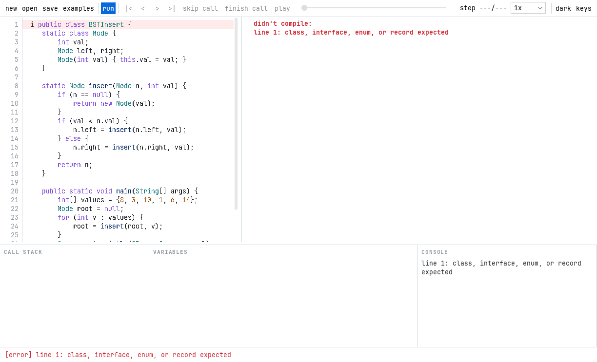

# 1. Introduction

## 1.1 The problem
A program's text shows what it says, not what it does. When a student writes

```java
curr.next = prev;
prev = curr;
curr = next;
```

the effect on memory is invisible: an arrow turns around, two variables slide one node along the list. Students learn this by tracing on paper: drawing boxes and arrows, and redrawing them after every line. This is slow, and a wrong drawing teaches the wrong lesson. A debugger shows the values, but as a flat list of variables and object ids. It doesn't show the shape of a list or a tree, and it can't step backwards.

Data structures and algorithms (DSA) courses are where this hurts most. Linked lists, trees, B-trees and dynamic-programming tables are all defined by how objects point at each other and how that changes over time.

## 1.2 What Raphael does
Raphael is a desktop application that shows data structures changing while a Java program runs. The user types, pastes or opens a single-file Java program and presses **run**. Raphael then:

1. compiles it with the JDK's own compiler,
2. runs it in a second Java virtual machine, pausing before every line,
3. copies the program's variables and objects at every pause,
4. recognises arrays, grids, linked lists, binary trees, B-trees and other objects, and
5. draws them in a window, animating each change, with the code beside the picture.

The user can play the run like a video, step forward and back, skip over or out of method calls, or jump to any line. Index variables such as `i` and `j` appear as markers under the array cells they index, and the cells the next line will read or write are outlined.



## 1.3 Goals
Raphael started as the course project for Object-Oriented Programming in Java. Its goals then were to:
- work on the student's own code, not on prepared demonstrations;
- draw structures the way a textbook does, not as a generic object graph;
- make every change visible, through animation;
- be built with clear object-oriented design, every concept explainable.

After the course submission, the goal widened to a product anyone can download (ROADMAP.md). It should be production-grade on Windows, macOS and Linux, open source, and better than the existing tools described in chapter 2.

## 1.4 The project in numbers (version 1, 2026-11-01)

| | |
|---|---|
| Source files | 61 Java files, about 7,300 lines, in 6 packages |
| Tests | 107 JUnit 5 tests in 17 files, about 1,900 lines |
| Example programs | 9 (bubble sort, list reversal, BST insert, Fibonacci DP, grid DP, a buggy list, an off-by-one crash, B-tree insert, bank accounts) |
| Outside libraries | 1 (FlatLaf, for the look of buttons and menus) |

## 1.5 How this report is organised
- Chapter 2 compares Raphael with the existing tools.
- Chapter 3 explains the parts of the JDK it is built on.
- Chapter 4 describes its architecture: how a program's text becomes an animated picture.
- Chapter 5 maps the object-oriented concepts to the classes that use them.
- Chapters 6 to 8 cover the features, exception and file handling, and testing.
- Chapters 9 and 10 give the results and the limits.
